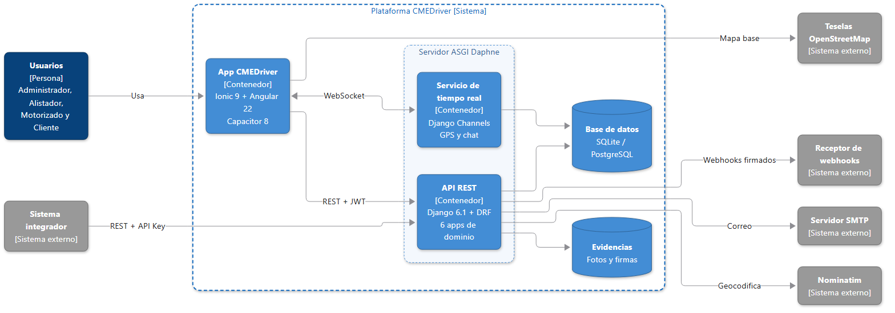

# 5. Metodología

Este capítulo retoma, sin replantearlos, el problema, la pregunta y los cuatro objetivos específicos de la sección 3.3 y explica cómo se estudió y construyó CMEDriver, distinguiendo lo implementado, lo simulado y lo planificado para Trabajo de Grado, donde Logytech Mobile es la organización de aplicación.

## 5.1 Enfoque, tipo y diseño de la investigación

La pregunta de investigación es de diseño y no de medición: indaga cómo integrar, en una plataforma orientada a API, la operación de mensajería, el seguimiento en tiempo real, la evidencia digital y el chat entre cliente y mensajero. Por eso el estudio es **investigación aplicada de desarrollo tecnológico**, guiada por Design Science Research (DSR), que genera conocimiento al construir un artefacto (Peffers et al., 2007): el problema y los requisitos corresponden al Objetivo 1; el diseño y el desarrollo, a los Objetivos 2 y 3; la demostración, a pruebas automatizadas y recorridos con roles simulados, que no son evaluación empírica; la evaluación, solo al protocolo del Objetivo 4, aún sin ejecutar; y la comunicación, a este documento.

El enfoque es **cualitativo-descriptivo en esta etapa**. Siguiendo la postura pragmática de Hernández-Sampieri y Mendoza Torres (2018), el problema determina el método: sin datos de usuarios reales no hay variables que medir ni hipótesis causales, y afirmar mejoras sería infundado, por lo que se descarta por ahora la ruta cuantitativa. La ruta será **mixta** en Trabajo de Grado (entrevistas y observación; listas de chequeo y escalas de percepción). La **naturaleza** es descriptiva y de desarrollo, y el **diseño**, de ciclos iterativos de construcción con evaluación diferida, sin alcance para comprobar causalidad.

## 5.2 Población, usuarios, técnicas e instrumentos

En esta etapa no hay población ni muestra: la unidad de análisis es el **proceso de un servicio de mensajería**, las fuentes son la literatura y el análisis del dominio, y los cuatro roles fueron **simulados**. Para Trabajo de Grado se **diseña y planifica** una población de personal administrativo y de alistamiento, motorizados y clientes de Logytech Mobile, sujeta a su autorización y con muestreo por conveniencia (resultados no generalizables); el número de participantes y el criterio de selección se definirán con la organización. La Tabla 4 separa los instrumentos usados de los planificados; **ninguno de los segundos se ha aplicado.**

**Tabla 4**

*Técnicas e instrumentos: usados y planificados*

| Técnica | Instrumento | Para qué sirve | Aplicado a | Estado |
|---|---|---|---|---|
| Revisión documental | Matriz de fuentes; fichas RF/RNF | Caracterizar el problema y derivar requisitos | Literatura y dominio | Usado |
| Modelado, prototipado y pruebas | Casos de uso, ER, C4, mockups; 72 pruebas automatizadas | Documentar, hacer tangibles y verificar los requisitos | Artefacto y código | Usado |
| Entrevista y observación | Guion semiestructurado; pauta de observación | Validar requisitos y contrastar el flujo con la práctica | Personal y motorizados de Logytech Mobile | Planificado |
| Encuesta | Cuestionario con escala de usabilidad | Medir la percepción del seguimiento y del chat | Clientes de Logytech Mobile | Planificado |
| Prueba piloto | Lista de chequeo de flujos centrales | Verificar que cada flujo se completa con usuarios reales | Los cuatro roles | Planificado |

*Nota.* Fuente: Elaboración propia.

## 5.3 Herramientas, proceso de selección y arquitectura

La selección siguió cuatro pasos: listar las capacidades que exigen los objetivos, identificar alternativas, puntuarlas con criterios explícitos (costo cero y sin credenciales, rapidez, soporte de los requisitos, evolución a producción y madurez) y registrar la decisión y la alternativa descartada (Tabla 5). Provienen de la documentación técnica del proyecto (Anexo A) y no de un estudio comparativo formal, lo que se reconoce como limitación.

**Tabla 5**

*Selección de herramientas y tecnologías*

| Capa | Seleccionada | Alternativa considerada | Criterio decisivo |
|---|---|---|---|
| Backend y autenticación | Django y DRF; JWT y API Key propia | FastAPI; OAuth2 completo | ORM, administración y autenticación integrados |
| Tiempo real | Channels y Daphne, con respaldo a sondeo | Solo sondeo | Difusión push de GPS y chat; el respaldo da resiliencia |
| Base de datos | SQLite (desarrollo); PostgreSQL (propuesta) | PostgreSQL desde el inicio | Cero configuración; mismo ORM después |
| Frontend y empaquetado | Angular e Ionic; Capacitor | Aplicaciones por rol; nativo | Un código para cuatro roles; Android sin verificar |
| Mapas y geocodificación | Leaflet, OpenStreetMap y Nominatim | Google Maps Platform | Sin llave ni facturación; una solicitud por segundo |
| Correo | Backend de consola de Django (**simulado**) | Proveedor transaccional | Sin cuenta ni credenciales |

*Nota.* Fuente: Elaboración propia a partir de la documentación técnica del proyecto (Anexo A).

La arquitectura es **modular y orientada a API**: seis aplicaciones de dominio (cuentas, cobertura, servicios, seguimiento, optimización e integraciones) en un backend único con 12 entidades, documentada con el modelo C4 (Brown, s. f.); la Figura 1 resume el nivel de contenedores. La aplicación Ionic y Angular consume la API REST con JWT y recibe posiciones y mensajes por WebSocket; el chat admite solo al cliente propietario del servicio y al motorizado asignado, lo que verifican pruebas automatizadas. Los sistemas externos usan API Key y reciben webhooks firmados con HMAC.

**Figura 1**

*Diagrama C4 resumido, nivel de contenedores de CMEDriver*

*Nota.* Fuente: Elaboración propia. El diagrama completo y los demás niveles están en el Anexo A.

**Lo que se simula** es poco: los usuarios, de prueba, y, en desarrollo, el correo de restablecimiento, que se imprime en consola. Lo demás se ejecuta de verdad, pero en desarrollo: el sistema no está desplegado.

## 5.4 Metodología de desarrollo

Frente a las tres familias de procesos de la guía de la asignatura, la cascada se descartó porque los requisitos cambian y no hay un cliente real que los fije; Scrum exige roles y equipo (Schwaber & Sutherland, 2020) y trabajó una persona con asesoría docente, por lo que se adoptaron sus prácticas pero no el marco; y se eligió el desarrollo **por prototipos**, con documentación en paralelo para mitigar su riesgo de documentación escasa.

El desarrollo fue **incremental por prototipos, con iteraciones de inspiración ágil**: se entregó software funcionando por fases (núcleo con roles, servicios y evidencia; tiempo real y planificación de recolecciones; optimización de rutas, claves de API y webhooks) y se aceptaron cambios entre fases, como el ajuste de alcance de octubre de 2026 (sección 3.5). **No se aplicó Scrum completo**: no hubo roles diferenciados ni sprints formales. Las etapas son MVP y versión 2 (realizadas), Entrega 3 con avance de resultados y, en Trabajo de Grado, validación con usuarios, pruebas definitivas y despliegue.

## 5.5 Actividad 3: síntesis metodológica

**Tabla 6**

*Tipo de investigación, metodología, herramientas y arquitectura*

| Tipo de investigación | Metodología de desarrollo | Herramientas y tecnologías | Arquitectura propuesta |
|---|---|---|---|
| Aplicada (DSR), cualitativo-descriptivo; mixta en Trabajo de Grado | Incremental por prototipos con iteraciones de inspiración ágil | Django y DRF, Channels, Angular e Ionic, SQLite y PostgreSQL, Leaflet y Nominatim | Modular orientada a API (REST, WebSocket y webhooks), documentada con C4 |

*Nota.* Fuente: Elaboración propia.

## 5.6 Coherencia con la Entrega 1

**Tabla 7**

*Coherencia: objetivos específicos y decisiones que los respaldan (¿se logran?)*

| Objetivo específico (sección 3.3) | Decisión metodológica o arquitectónica | ¿Se logra? |
|---|---|---|
| 1. Identificar problemas y derivar requerimientos | Enfoque cualitativo; revisión documental y fichas RF/RNF | Sí, con fuentes secundarias; contraste en Trabajo de Grado |
| 2. Diseñar y documentar la arquitectura y modelarla | Seis aplicaciones y 12 entidades; REST, WebSocket y webhooks; UML, ER, C4 y mockups | Sí |
| 3. Implementar el prototipo funcional temprano | Incremental por prototipos; herramientas de la Tabla 5 | Sí, con 72 pruebas, usuarios simulados y Android sin verificar |
| 4. Formular el protocolo de validación | Instrumentos de la Tabla 4; ruta mixta | Se formula; se ejecuta en Trabajo de Grado |

*Nota.* Fuente: Elaboración propia.

## 5.7 Consideraciones éticas y declaración de uso de inteligencia artificial

CMEDriver trata datos personales (nombres, teléfonos, direcciones, GPS, fotos, firmas y chats), sujetos a la Ley 1581 de 2012. Hoy son datos de prueba; con personas reales se requerirán autorización informada, finalidad definida y medidas de seguridad. El software no se registrará ante la Dirección Nacional de Derecho de Autor en esta etapa, por ser un desarrollo para Logytech Mobile, con quien se definirá su titularidad (sección 4.8).

**Declaración de uso de IA.** Se empleó Claude (Anthropic, 2026) como asistente en cuatro actividades: borradores de este documento, búsqueda y verificación inicial de fuentes, documentación y diagramas técnicos, y modificación y prueba del código. El estudiante supervisó, editó y verificó el contenido y las fuentes; el asistente no sustituye su autoría ni su responsabilidad. El prototipo no incorpora ningún modelo de lenguaje en su ejecución.
