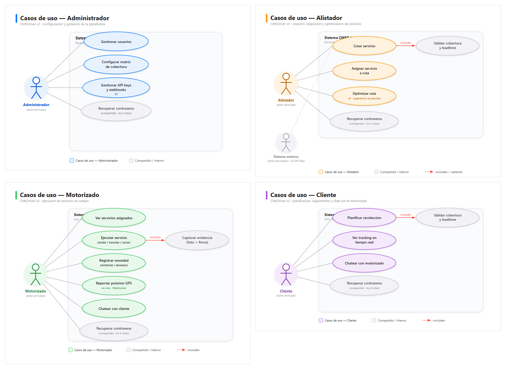
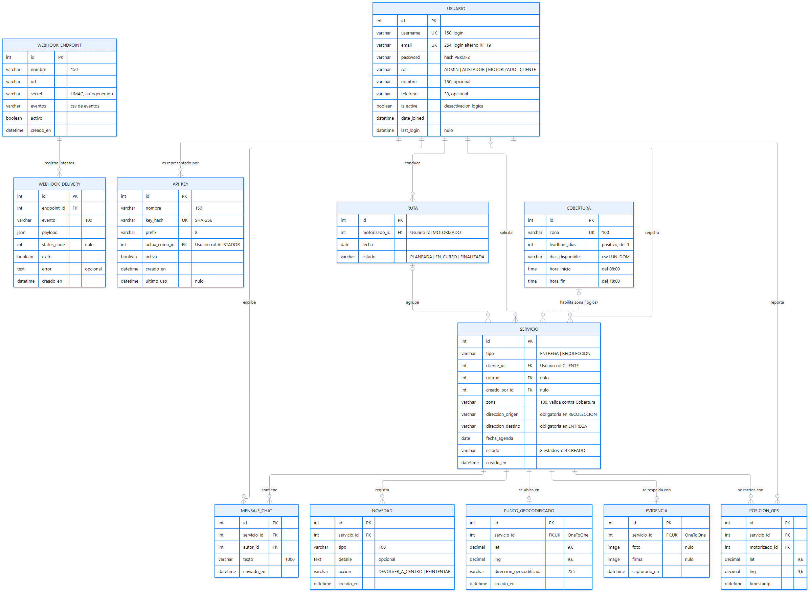
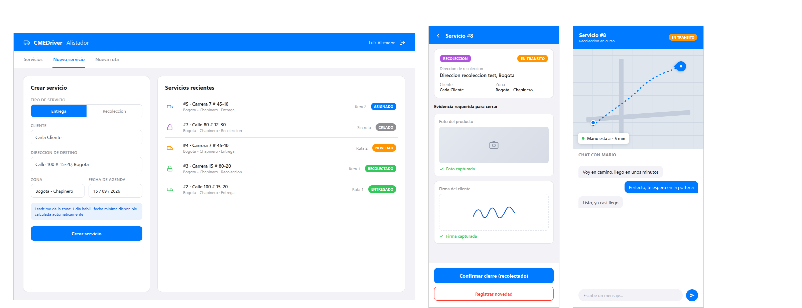
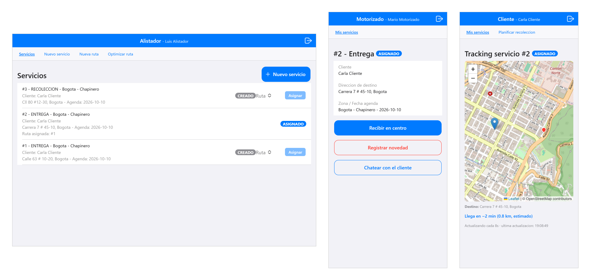

# 6. Avance de Resultados

Este capítulo presenta lo tangible que existe al cierre de la Entrega 3: el diseño inicial de CMEDriver, el prototipo que lo materializa y la evidencia de cada objetivo específico de la sección 3.3. Se distingue lo implementado, lo simulado y lo pendiente; no se reporta ningún resultado empírico, porque no existen usuarios reales ni mediciones.

## 6.1 Diseño inicial

La Figura 2 muestra los casos de uso por actor: el Administrador gestiona usuarios, cobertura, claves de API y webhooks; el Alistador crea y asigna servicios y rutas; el Motorizado ejecuta el servicio y captura evidencia, novedades y posición; y el Cliente consulta el seguimiento, agenda recolecciones y conversa con el motorizado. Cada rol tiene casos de uso acotados, traducidos en permisos por rol en el backend, y la validación de cobertura y de anticipación es obligatoria en el agendamiento.

**Figura 2**

*Casos de uso de CMEDriver por actor*

*Nota.* Fuente: Elaboración propia.

La Figura 3 presenta el modelo entidad-relación, con 12 entidades. El servicio es la entidad central: se relaciona con una ruta, admite como máximo una evidencia y concentra novedades, mensajes y posiciones, de modo que su historia se reconstruye desde un solo identificador. Un límite del diseño: la cobertura se asocia al servicio por el texto de la zona y no por una clave foránea (Anexo A). La arquitectura ya se presentó en la Figura 1 (Brown, n.d.).

**Figura 3**

*Modelo entidad-relación de CMEDriver (12 entidades)*

*Nota.* Fuente: Elaboración propia.

Los mockups de la Figura 4 hacen tangible la interfaz antes del código: la creación de servicio del Alistador distingue entrega y recolección desde el primer campo; el cierre de recolección del Motorizado bloquea hasta que existan foto y firma, regla que el backend también impone; y el seguimiento del Cliente combina mapa, hora estimada y chat. Son estáticos y el prototipo no replica su estilo visual.

**Figura 4**

*Mockups de pantallas clave: Alistador, Motorizado y Cliente*

*Nota.* Fuente: Elaboración propia.

## 6.2 Prototipo funcional temprano

El prototipo está en https://github.com/javier5254/CEMDriver: un backend Django con seis aplicaciones y una aplicación Angular e Ionic con áreas para los cuatro roles. Se ejecuta en desarrollo, con datos de prueba, y funcionan de punta a punta el inicio de sesión con JWT y roles, el ciclo de vida del servicio con novedades, la cobertura y la planificación de recolecciones, la evidencia con foto y firma, el seguimiento GPS por WebSocket, el chat entre el cliente propietario y el motorizado asignado, la sugerencia de orden de visita y las claves de API con webhooks firmados. La Figura 5 reúne capturas reales de la aplicación en ejecución.

**Figura 5**

*Capturas de la aplicación CMEDriver en ejecución*

*Nota.* Fuente: Elaboración propia, a partir de capturas de la aplicación en ejecución con datos de prueba.

La evidencia automatizada es la suite del backend: 110 pruebas, todas en verde, sobre autenticación, cobertura, servicios, seguimiento, optimización e integraciones; tres verifican que el chat solo admite al cliente propietario y al motorizado asignado. Las pruebas demuestran que el comportamiento coincide con lo especificado, no que el sistema sea útil, y la aplicación Angular carece de pruebas equivalentes. Son simulados los cuatro roles, de prueba, y el correo de restablecimiento, que se imprime en consola. No está verificado el empaquetado nativo para Android, cuya compilación falló por una limitación del entorno. El inventario, los pagos y el asistente conversacional se retiraron del alcance en octubre de 2026 y no forman parte del prototipo.

## 6.3 Evidencia por objetivo

La Tabla 8 relaciona cada objetivo de la sección 3.3 con su evidencia.

**Tabla 8**

*Objetivos específicos y evidencia que los respalda*

| Objetivo específico (sección 3.3) | Evidencia concreta | Dónde verla |
|---|---|---|
| 1. Identificar problemas y derivar requerimientos | Seis problemas caracterizados con la literatura; 25 requerimientos funcionales y 19 no funcionales vigentes, con criterio de aceptación y prueba asociada | Secciones 3 y 4; Anexo A |
| 2. Diseñar y documentar la arquitectura y modelarla | Casos de uso, modelo entidad-relación de 12 entidades, modelo C4, diagramas de clases y mockups; seis aplicaciones con REST, WebSocket y webhooks | Figuras 1 a 4; Anexo A |
| 3. Implementar el prototipo funcional temprano | Flujos de servicio, GPS en tiempo real, chat cliente-motorizado y evidencia de recolección en ejecución; 110 pruebas en verde | Figura 5; repositorio |
| 4. Formular el protocolo de validación | Instrumentos y participantes previstos: entrevista, observación, encuesta y prueba piloto con lista de chequeo; aún sin aplicar | Tabla 4 |

*Nota.* Fuente: Elaboración propia.

## 6.4 Discusión preliminar

Frente a la pregunta de investigación, el avance muestra que una plataforma orientada a API puede reunir en un solo backend la gestión de servicios, el seguimiento, la evidencia y el chat: responde a la factibilidad técnica, pero no a si la integración mejora la coordinación en una empresa multinacional de logística, algo que no se mide ni se afirma. Por objetivo, el 1 se cumple con fuentes secundarias y falta contrastarlo con personal y clientes; el 2, en lo documental; el 3, en los flujos centrales, con las salvedades de la sección 6.2; y el 4 se formula, sin ejecutarse.

El avance se conecta con tres hallazgos del marco teórico. La sección 4.10 sostuvo que la última milla es un problema de coordinación y de información: el prototipo ofrece una capa de información compartida, pero que reduzca las fallas de coordinación sigue sin probarse. El rastreo también vigila el trabajo de reparto (Randerath & Friedrich, 2025): el prototipo registra la ubicación del motorizado sin aviso de privacidad ni autorización del titular, limitación prioritaria. Y la autorización por objeto debe residir en el backend (OWASP API Security Project, 2023): el chat lo cumple y las pruebas lo verifican, pero otros recursos aplican controles más débiles, de modo que el cumplimiento es parcial.

Las limitaciones acotan lo que puede concluirse: usuarios simulados, ejecución solo en desarrollo, y 35 limitaciones y 11 hallazgos abiertos en la documentación técnica. El avance es evidencia de diseño y de factibilidad, no de efectividad. En Trabajo de Grado se corregirán primero seguridad y datos personales, se ejecutará el protocolo del Objetivo 4 y se preparará el despliegue.
